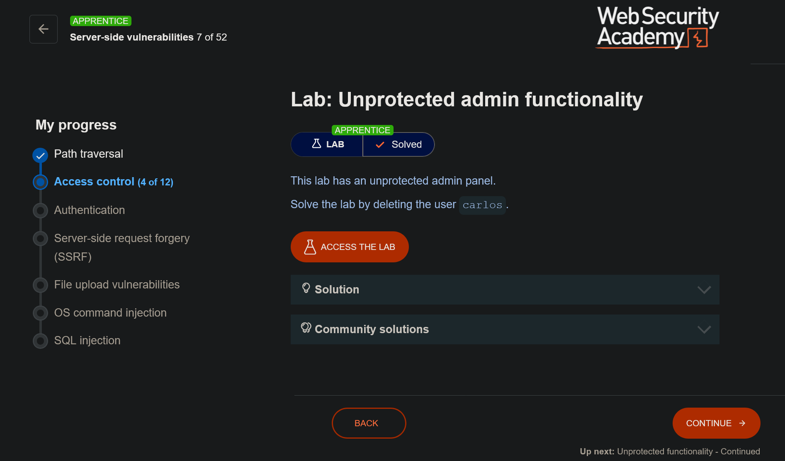
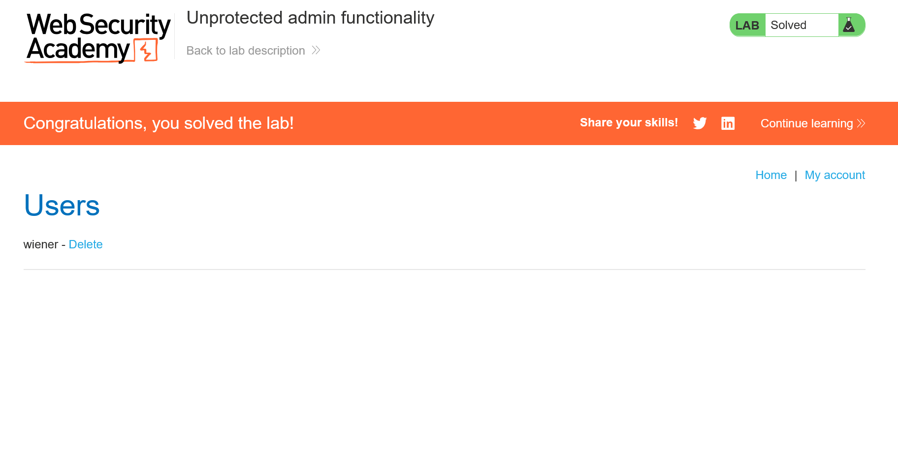

# Lab: Unprotected admin functionality (Server-side vulnerabilities 7 of 52, Apprentice) 

| Field      | Value |
|------------|-------|
| 📅 Event      | N/A |
| 🗂️ Category   | Web Exploitation, Apprentice |
| ⭐ Points     | N/A |
| 👥 Solves     | N/A |
| ✍️ Author     | N/A |
| 👤 Solved by  | Myself solo |
| 📊 Status     | Solved |

## ⚡ TL;DR
Access robots.txt file inside that website to see all of them.

## 🎯 Challenge

- 🌐 Service: `https://portswigger.net/web-security/learning-paths/server-side-vulnerabilities-apprentice/access-control-apprentice/access-control/lab-unprotected-admin-functionality` 

## 👀 First look

## 🛑 Dead ends
- NO IDEA

## 💡 Solution
### Step 1: 
Initialize Burp Suite’s software and browser as usual.

### Step 2: 
Continue by adding “/robots.txt” in your current search bar

### Step 3:
Copy-paste the “/administrator-panel”. Then replace “/robots.txt” into “/administrator-panel”. Finally, delete user carlos. SOLVED.

## 🚩 Flag

## 🧠 Lessons learned
- robots.txt

## 📚 References
- Lazy to write hehehe.
- U can check my Google Docs = https://docs.google.com/document/d/1uNSRxxjq0NtVCZeY56fqU0ZpUwEmdwb6l6sOys8xJb0/edit?usp=sharing

